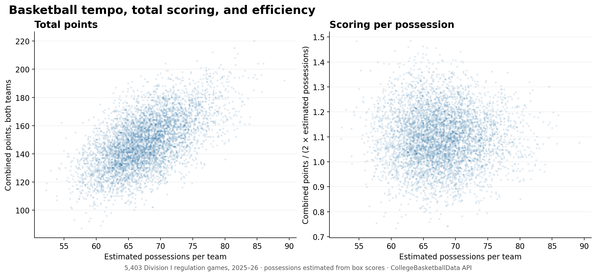

## Why I wanted to look at tempo

Unlike football, basketball has a definitive tempo statistic that has a real effect on the game, and it's something teams strategize around. I wondered how tempo actually affects an offense's scoring. Is strategizing for a high tempo a good and effective game plan for teams? More specifically, does faster tempo improve scoring efficiency, or mainly create more chances to score?

Faster games tended to have more combined points (*r* = 0.588), while game pace had almost no linear relationship with points per possession (*r* = −0.013).

## The data and how I got it

- **Source:** 2025–26 games and team box scores from the CollegeBasketballData API.
- **Unit:** one completed Division I game without overtime. Of 5,752 final games, 5,403 passed the checks; 325 went to overtime and 24 lacked a complete box score.
- **Features:** 11 columns, including game date, home and away teams and points, combined points, estimated possessions, points per possession, and game-site flags.
- **Curation:** joined the two API endpoints by game ID; checked that box and game scores match; estimated possessions from field-goal attempts, offensive rebounds, turnovers, and free-throw attempts.

It was fun to see all of the different endpoints that this API had and how many possible opportunities there are for collecting valuable basketball data. The CollegeBasketballData basketball dataset is extremely well done and very comprehensive. That was the most surprising thing for me. There's a lot of opportunity to continue to explore this data.

## Ethics and good API practice

I decided to use an API for this data both out of convenience and out of respect for the website: I wanted to get the data in the way it intended. In fact, I paid for the [$10 tier](https://www.collegebasketballdata.com/api-tiers) so I could make more calls for other football and basketball NCAA data analysis. I stored the API key outside the repo and made sure not to push it publicly. Even with a higher call allowance, I paced requests and left a quota reserve. The [API terms](https://collegebasketballdata.com/terms) restrict publishing its data as a standalone bulk dataset, so I'm sharing code, a graph, and a link to the API, but not the raw data I pulled.

## What the graph shows

I noticed that there is a general upward trend and a positive correlation between tempo and total points. But there's actually more noise than I would have initially guessed. I would've guessed that having a high tempo more closely leads to higher points, but it seems a lot more noisy.

This makes me wonder whether tempo is based more on the physical ability and play style of teams than on scoring efficiency.

| 2025–26 regulation games | Value |
|---|---:|
| Games in the graph | 5,403 |
| Median possessions per team | 67.4 |
| Median combined points | 148 |
| Correlation: tempo and total points | 0.588 |
| Correlation: tempo and points per possession | −0.013 |

## What I can and cannot conclude

One limitation I did not account for is that teams with more possessions might also have more fast breaks, and fast breaks could be higher-percentage scoring chances. I am not sure how best to isolate that pattern yet, but I would like to know whether fast-break possessions score more often and whether that changes the efficiency of teams that play at a higher tempo. The box-score table does not label fast breaks, and comparing games cannot tell me what would happen if a team deliberately changed its pace.

## If you want to try a similar project

It's very easy for someone to make a similar dataset to the one that I used for this project. First, you have to get a CBBD key and request the game and team box score data. You can join those two datasets by game ID and then estimate possessions from the box stats. Then you need to check the scores and graph the totals and points per possession.

## Links

- [Python code and figure on GitHub](https://github.com/jamesebrandt/stat386-basketball-tempo)
- [CollegeBasketballData API documentation](https://api.collegebasketballdata.com/)
- [Get a CollegeBasketballData API key](https://collegebasketballdata.com/key)
- [CollegeBasketballData terms of use](https://collegebasketballdata.com/terms)

